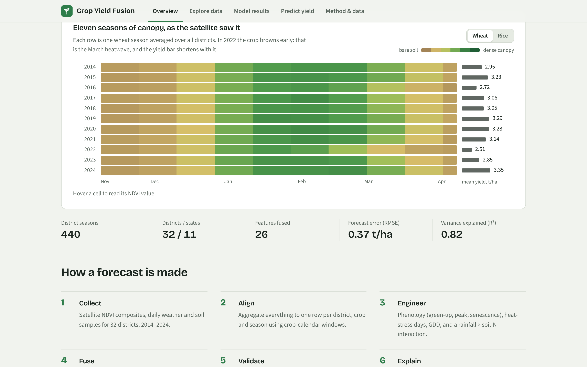
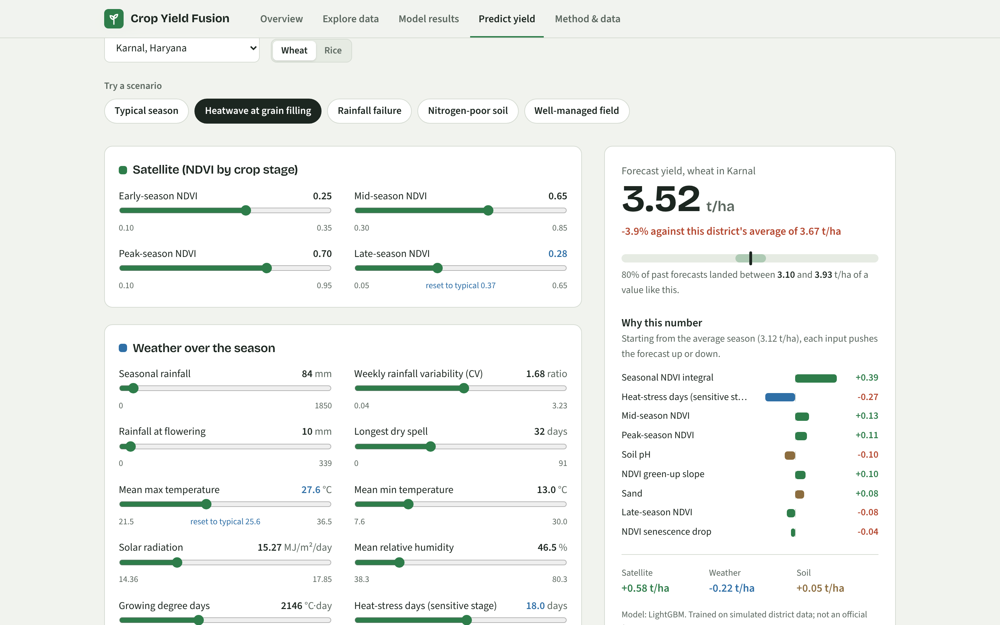
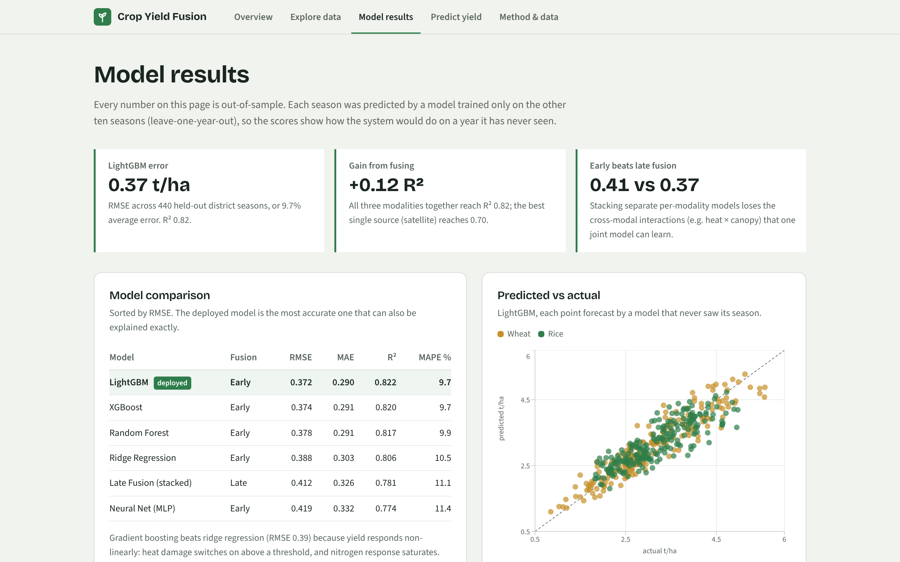

# Crop Yield Prediction via Multimodal Data Fusion

Predicts **wheat and rice yield (tonnes/hectare)** for 32 Indian districts by fusing three data sources:

| Modality | What it captures | Features |
|---|---|---|
| **Satellite** (NDVI) | canopy greenness through the season | early / mid / peak / late NDVI, green-up slope, senescence, seasonal NDVI integral |
| **Weather** | water and heat stress | seasonal & flowering rainfall, rainfall variability, longest dry spell, Tmax/Tmin, solar radiation, humidity, GDD, heat-stress days |
| **Soil** | long-term fertility constraints | pH, available nitrogen, organic carbon, sand / silt / clay |

Plus a cross-modal **rainfall × soil-N** interaction and crop type → **26 features**, 440 district-crop-seasons (2014–2024).

**Result (leave-one-year-out):** LightGBM, RMSE **0.37 t/ha**, MAPE **9.7 %**, R² **0.82**. Fusing all three modalities raises R² from 0.70 (best single source, satellite) to 0.82.



---

## Quick start (Windows)

Needs **Python 3.10–3.13** (3.12 recommended). Node.js is **not** needed: the dashboard is already built.

```powershell
# from inside this folder
.\setup.bat      # once: creates .venv, installs packages, builds data, trains (~2 min)
.\run.bat        # starts backend + dashboard, opens http://localhost:8000
```

PowerShell scripts are also included (`.\setup.ps1`, `.\run.ps1`). If PowerShell blocks them, run
`Set-ExecutionPolicy -Scope CurrentUser RemoteSigned` once, or just use the `.bat` files.

| URL | What |
|---|---|
| http://localhost:8000 | Dashboard (Overview, Explore data, Model results, Predict yield, Method) |
| http://localhost:8000/docs | Interactive API documentation (Swagger, works offline) |

### Manual commands
```powershell
py -3.12 -m venv .venv
.\.venv\Scripts\Activate.ps1
pip install -r requirements.txt
python -m cropyield.build_dataset          # data/crop_yield_multimodal.csv
python -m cropyield.train                  # models/, reports/, reports/figures/
python -m pytest -q                        # 11 tests
python -m uvicorn api.main:app --port 8000
```

### Notebook walkthrough
`notebooks/crop_yield_walkthrough.ipynb` is already executed: open it in VS Code or Jupyter to read the whole pipeline
(EDA, LOYO vs random split, model comparison, ablation, SHAP, scenario forecast) with outputs. To re-run it:
`pip install notebook` then `jupyter notebook notebooks/`.

### Use REAL NASA POWER weather (needs internet, ~2 min)
```powershell
python -m cropyield.nasa_power                     # downloads daily weather for all 32 districts
python -m cropyield.build_dataset --weather nasa   # rebuild dataset with real weather
python -m cropyield.train
```
The dashboard's Method page then shows "NASA POWER (real)" as the weather source.

---

## Project structure
```
crop_yield_fusion/
├── cropyield/                 # ML package
│   ├── config.py              # districts, crop calendars, feature groups, paths
│   ├── simulator.py           # agronomic simulator: daily weather, soil, NDVI, yield
│   ├── nasa_power.py          # real weather downloader (NASA POWER API)
│   ├── season.py              # daily -> crop-season aggregation (shared by real & synthetic)
│   ├── build_dataset.py       # builds the fused district x crop x season table
│   ├── features.py            # phenology, interaction and context features
│   ├── models.py              # Ridge, Random Forest, XGBoost, LightGBM, MLP
│   ├── fusion.py              # late fusion (per-modality models + stacked meta-learner)
│   ├── validation.py          # LOYO, leave-districts-out, metrics
│   ├── explain.py             # exact SHAP contributions
│   ├── train.py               # full experiment pipeline
│   └── predict.py             # inference + explanation for one season
├── api/
│   ├── main.py                # FastAPI app (serves API + dashboard)
│   ├── schemas.py             # validated request models
│   └── static/                # built React dashboard
├── web/                       # React + Vite + Tailwind + Recharts source of the dashboard
├── tests/test_project.py      # data, aggregation, NASA parser, API tests
├── notebooks/                 # executed walkthrough notebook
├── data/                      # generated datasets
├── models/model_bundle.joblib # deployed model + presets + intervals
├── reports/                   # CSV/JSON results + figures/ (PNG, ready for the report/PPT)
└── docs/                      # project report, architecture, data dictionary, viva guide, screenshots
```

## Pipeline
1. **Collect**: daily weather, 16-day NDVI composites, yearly soil samples per district.
2. **Align**: aggregate to crop-stage windows from the crop calendar (wheat Nov–Apr, rice Jun–Oct).
3. **Engineer**: phenology metrics, heat-stress days during flowering/grain-fill, GDD, rainfall × soil-N.
4. **Fuse**: early fusion (one table, one model) vs late fusion (one model per modality + stacking).
5. **Validate**: leave-one-year-out (11 folds) + leave-districts-out spatial check + modality ablation.
6. **Explain**: TreeSHAP per prediction, rolled up by modality; 80 % intervals from out-of-sample residuals.

## Results (synthetic-data build)
| Model | Fusion | RMSE | MAE | R² | MAPE % |
|---|---|---|---|---|---|
| **LightGBM** | Early | **0.372** | **0.290** | **0.822** | **9.7** |
| XGBoost | Early | 0.374 | 0.291 | 0.820 | 9.7 |
| Random Forest | Early | 0.378 | 0.291 | 0.817 | 9.9 |
| Ridge Regression | Early | 0.388 | 0.303 | 0.806 | 10.5 |
| Late fusion (stacked LightGBM) | Late | 0.412 | 0.326 | 0.781 | 11.1 |
| Neural net (MLP) | Early | 0.419 | 0.332 | 0.774 | 11.4 |

| Modalities | R² |
|---|---|
| Soil only | 0.55 |
| Weather only | 0.64 |
| Satellite only | 0.70 |
| Satellite + Weather | 0.77 |
| Weather + Soil | 0.79 |
| Satellite + Soil | 0.79 |
| **All three** | **0.82** |

Exact numbers are regenerated in `reports/` every time you train.

## API
| Method | Endpoint | Purpose |
|---|---|---|
| GET | `/api/health` | status + deployed model |
| GET | `/api/meta` | input definitions, ranges, district presets |
| GET | `/api/overview` | KPIs, yield by state/year, district points |
| GET | `/api/ndvi-strips` | NDVI season composites per year |
| GET | `/api/dataset?crop=&state=&district=` | rows of the fused dataset |
| GET | `/api/district/{name}?crop=` | yield history + NDVI curves for one district |
| GET | `/api/metrics` | all evaluation tables |
| GET | `/api/predictions` | out-of-sample LOYO predictions |
| POST | `/api/predict` | forecast + 80 % interval + SHAP breakdown |

```json
POST /api/predict
{"crop": "Wheat", "district": "Karnal", "inputs": {"ndvi_peak": 0.78, "heat_stress_days": 4}}
```
Missing inputs are filled with the district's typical values.

## Screenshots
| Predict (heatwave scenario) | Model results |
|---|---|
|  |  |

## Editing the dashboard (optional, needs Node 18+)
```powershell
cd web
npm install
npm run dev      # http://localhost:5173 with hot reload (keep the backend running on :8000)
npm run build    # rebuilds api/static
```

## Data honesty
NDVI, soil and yield are **simulated** with crop-science response curves, because official district yields, satellite rasters
and Soil Health Card data need accounts and extensive GIS processing. Weather can be **real** (NASA POWER). Scores describe the
simulated world and demonstrate the method; replace the yield labels with official statistics before making agronomic claims.
See `docs/PROJECT_REPORT.md`, section 3.

## Team
Snehaal Mukherjee (1/23/SET/BCS/350), Krishna Bhatia (1/23/SET/BCS/358), Prateek Singh (1/23/SET/BCS/362), Aryaman (1/23/SET/BCS/364).
B.Tech CSE (AI & ML), Manav Rachna International Institute of Research and Studies, Faridabad.
